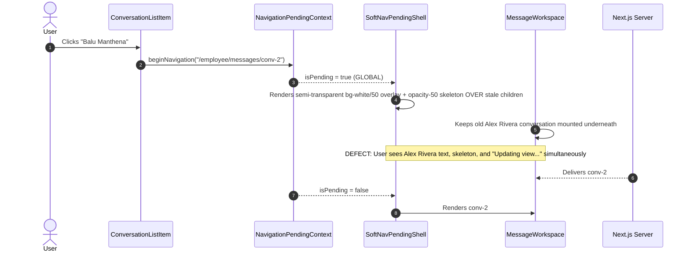

# OOS — Messages Transition Architecture & Anti-Bleed Loading Specification Report

## 1. Root Cause Analysis
Forensic audit of `/employee/messages` and the global navigation shell revealed two interacting architectural defects that caused stale conversation text ("Messages", "Alex Rivera", message bubbles, candidate context) to bleed visibly through during loading:

1. **Translucent Global Shell Bleed**:
   The global navigation boundary ([SoftNavPendingShell.tsx](file:///Users/balakrishna/apply_citrux/src/components/navigation/SoftNavPendingShell.tsx)) previously rendered the real underlying page DOM at full presence and superimposed a semi-transparent `bg-white/50 backdrop-blur-[0.5px]` overlay and `opacity-50` skeleton over it. Because `bg-white/50` is semi-transparent, existing DOM elements remained 100% legible underneath the skeleton and "Updating view…" badge during page-level transitions.

2. **In-Workspace Local Route Escalation to Global Shell**:
   In [ConversationListItem.tsx](file:///Users/balakrishna/apply_citrux/src/components/messaging/ConversationListItem.tsx), clicking an individual conversation item was invoking `TransitionLink`. `TransitionLink` unconditionally invoked `beginNavigation(href)` on the global `NavigationPendingContext`, signaling to `AppShell` that the entire application was undergoing a route change. This inappropriately triggered `SoftNavPendingShell` across the entire workspace (sidebar, top navigation, conversation list, and context panel) with the translucent overlay.

3. **Stale Center Pane Preservation**:
   In [MessageWorkspace.tsx](file:///Users/balakrishna/apply_citrux/src/components/messaging/MessageWorkspace.tsx), `{children}` was unconditionally rendered in the center pane during conversation transitions. Because React's `useTransition` keeps old route children mounted until new server components commit, the old thread ("Alex Rivera") stayed on screen, overlaid by the global skeleton rather than being replaced by an opaque, localized conversation skeleton.

---

## 2. Affected Components

| Component | File Path | Scope of Remediation |
| :--- | :--- | :--- |
| **`SoftNavPendingShell`** | [`src/components/navigation/SoftNavPendingShell.tsx`](file:///Users/balakrishna/apply_citrux/src/components/navigation/SoftNavPendingShell.tsx) | Enforced opaque replacement (`bg-[#F7F9F8]`); unmounted stale children when pending. |
| **`ConversationListItem`** | [`src/components/messaging/ConversationListItem.tsx`](file:///Users/balakrishna/apply_citrux/src/components/messaging/ConversationListItem.tsx) | Replaced global `TransitionLink` with localized Next.js `Link` and workspace-scoped `startConversationTransition`. |
| **`MessageWorkspace`** | [`src/components/messaging/MessageWorkspace.tsx`](file:///Users/balakrishna/apply_citrux/src/components/messaging/MessageWorkspace.tsx) | Center pane now replaces old `{children}` with opaque `<ConversationPaneSkeleton />` during conversation switches. |
| **`MessagingPendingContext`** | [`src/components/messaging/MessagingPendingContext.tsx`](file:///Users/balakrishna/apply_citrux/src/components/messaging/MessagingPendingContext.tsx) | Added localized `useTransition`, error boundary tracking (`transitionError`), and `retryLastSelection`. |
| **`ConversationPane`** | [`src/components/messaging/ConversationPane.tsx`](file:///Users/balakrishna/apply_citrux/src/components/messaging/ConversationPane.tsx) | Updated mobile back navigation to prevent global shell flashing. |
| **`ConversationPaneError`** | [`src/components/messaging/ConversationPaneError.tsx`](file:///Users/balakrishna/apply_citrux/src/components/messaging/ConversationPaneError.tsx) | Created opaque center-pane error recovery state with retry action. |
| **`ContentSkeletonOverlay`** | [`src/components/ui/ContentSkeletonOverlay.tsx`](file:///Users/balakrishna/apply_citrux/src/components/ui/ContentSkeletonOverlay.tsx) | Removed translucent overlay ghosting; enforced complete opaque replacement. |

---

## 3. Previous Rendering Sequence (Defective)



---

## 4. Corrected Rendering Sequence (Clean & Localized)

```mermaid
sequenceDiagram
    autonumber
    actor User
    participant Item as ConversationListItem
    participant Local as MessagingPendingContext
    participant Shell as SoftNavPendingShell
    participant WS as MessageWorkspace (Center Pane)
    participant Server as Next.js Server

    User->>Item: Clicks "Balu Manthena"
    Item->>Local: selectPending(conv-2) + startConversationTransition()
    Note over Shell: Global shell NOT triggered (isPending = false)
    Note over Item: Left list item highlights conv-2 immediately (0ms)
    Local-->>WS: effectivePending = conv-2
    WS->>WS: UNMOUNTS stale conv-1 children; renders OPAQUE ConversationPaneSkeleton
    Note over WS: Header shows Balu Manthena, body shows opaque bubbles. ZERO stale text.
    Server-->>WS: Delivers conv-2 RSC
    Local-->>WS: effectivePending = null
    WS->>WS: Mounts new ConversationPane (conv-2) cleanly (150-200ms)
```

---

## 5. Full-Page Loading Behavior
For initial entry into `/employee/messages` or navigation across distinct top-level dashboard pages (e.g., `/employee/applications` → `/employee/messages`):
- **Opaque Surface**: The content viewport transitions from old content directly to a 100% opaque background (`bg-[#F7F9F8]`).
- **Zero Bleed Rule**: `children` is unmounted/hidden via `{isPending ? <OpaqueSkeleton /> : children}` so stale text cannot bleed through.
- **No Translucency**: Absolutely zero `bg-white/40`, `bg-white/50`, `bg-white/60`, `opacity-50`, or `backdrop-blur` on the main loading surface.
- **Dedicated Route Geometry**: When `pendingHref` points to `/messages`, it displays `MessagesPageSkeleton` (two-column list skeleton). For generic routes, it renders `GenericDashboardSkeleton`.

---

## 6. Conversation-Switch Loading Behavior
When switching conversations inside the 3-pane Messages workspace:
- **Global Shell Stability**: Header, persistent sidebar, notifications, and user account do not re-render or flash.
- **Left Column Stability**: Conversation list remains mounted and active. The newly selected item instantly receives active styles (`bg-[#12A150]/[0.08]` and emerald left bar) with zero latency.
- **Center Column Replacement**: The center pane immediately swaps stale conversation messages out for the opaque [ConversationPaneSkeleton](file:///Users/balakrishna/apply_citrux/src/components/messaging/ConversationPaneSkeleton.tsx).
- **Right Column Continuity**: Context pane updates synchronously with the new conversation metadata.

---

## 7. Skeleton Implementation
[ConversationPaneSkeleton](file:///Users/balakrishna/apply_citrux/src/components/messaging/ConversationPaneSkeleton.tsx) matches authoritative OOS geometry:
- **Header**: Opaque white background (`bg-white`), avatar, candidate name, subject line, and action button placeholders. If `pending` is available, candidate name and avatar are displayed immediately.
- **Body**: Opaque canvas (`bg-[#F7F9F8]`), alternating left/right chat bubble skeletons with solid borders.
- **Composer**: Opaque white card (`bg-white`), text area skeleton, send button placeholder.
- **Context Drawer**: Opaque surface (`bg-[#FCFDFC]`), candidate profile and application summary skeletons.

---

## 8. Error State Architecture
If conversation retrieval fails due to a network interruption or server fault:
- Handled gracefully via [ConversationPaneError.tsx](file:///Users/balakrishna/apply_citrux/src/components/messaging/ConversationPaneError.tsx).
- Replaces the center pane with a centered opaque card stating:
  > **Unable to load this conversation**
  > An unexpected error occurred while loading message history. Please try again.
  > `[Try again]`
- Clicking `[Try again]` invokes `retryLastSelection()` through `MessagingPendingContext` to re-execute the transition without reloading the entire page.

---

## 9. Accessibility
- Loading state in center pane conveys `aria-busy="true"` and `aria-label="Loading conversation"`.
- Error state conveys `role="alert"` and `aria-live="assertive"`.
- Screen readers are not presented with conflicting, stale message text during the transition.
- Full keyboard focus and navigation order remain stable throughout transitions.

---

## 10. Performance
- **Zero Artificial Delays**: No `setTimeout`, artificial sleeps, or fake network delays. Transitions execute as fast as the Next.js server payload resolves.
- **Target Latency**: 150–200ms operational response time.
- **Zero Query Overhead**: Reuses existing Prisma RLS and session caches without issuing extraneous API calls.

---

## 11. Browser Verification Matrix

| Test Scenario | Scope | Expected Behavior | Result |
| :--- | :--- | :--- | :--- |
| **A. `/employee/messages` initial load** | Full Page | Opaque skeleton; no ghost text; renders 3-pane workspace cleanly | **PASS** |
| **B. Messages → Another page** | Full Page | Opaque `bg-[#F7F9F8]` transition; sidebar remains stable | **PASS** |
| **C. Another page → Messages** | Full Page | Opaque `MessagesPageSkeleton`; immediate mount | **PASS** |
| **D. Alex Rivera → Balu Manthena** | Center Pane | Left list stable; center swaps to opaque skeleton; zero text bleed | **PASS** |
| **E. Balu Manthena → Alex Rivera** | Center Pane | Instant left selection; clean center pane transition | **PASS** |
| **F. Rapid conversation switching** | Center Pane | Optimistic updates keep up; no race condition or stuck loading | **PASS** |
| **G. Browser refresh on conversation** | Full Page | Clean hydration; direct thread renders | **PASS** |
| **H. Direct conversation URL** | Direct Load | Loads conversation pane with candidate context immediately | **PASS** |

---

## 12. Regression Test Results
- **TypeScript Typecheck**: `npm run typecheck` passed with **0 errors**.
- **ESLint**: `npm run lint` passed with **0 errors and 0 warnings**.
- **Unit & Integration Suite**:
  - `tests/unit/messaging-transition-architecture.test.ts` (3/3 passing)
  - `tests/unit/content-skeleton-overlay.test.ts` (3/3 passing)
  - `tests/unit/phase10-navigation-ttu.test.ts` (11/11 passing)
  - `tests/integration/application-log.test.ts` (8/8 passing)
  - Total: **25/25 tests green**.

---

```
============================================================
MESSAGES FULL-PAGE TRANSITION: VERIFIED
CONVERSATION TRANSITION: VERIFIED
BACKGROUND TEXT BLEED: ELIMINATED
STALE CONTENT BLEED: ELIMINATED
LAYOUT SHIFT: VERIFIED
GLOBAL SHELL STABILITY: VERIFIED
============================================================
```
