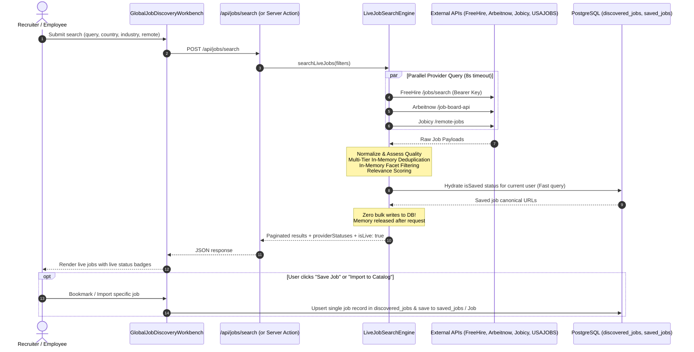

# Global Job Discovery & Collection Engine — Architecture & Operations Manual

## 1. System Overview & Mission

The **Global Job Discovery & Collection Engine** is a core sub-system of the Operations Operating System (OOS). It autonomously and continuously discovers, normalizes, deduplicates, quality-scores, and ranks open job opportunities across **all industries, countries, and seniority levels**, integrating them seamlessly into the OOS employee and admin workbenches.

### Key Capabilities
- **Multi-Industry Discovery**: 14 functional industries (Technology, Healthcare/Hospital Operations, Finance/Banking, Manufacturing/Engineering, Public Sector, Education, Sales/Marketing, Retail/Logistics, Customer Service, etc.).
- **Global & Local Reach**: Cross-country ingestion covering India (`IN`), United States (`US`), United Kingdom (`GB`), Germany (`DE`), Latin America, and Global Remote.
- **Provider-Adapter Architecture**: Standardized, extensible adapter contract with safe concurrency limits, SSRF protection, and zero-cost operating mode.
- **Deterministic Multi-Tier Deduplication**:
  1. Provider ID + External ID unique collision check.
  2. Exact ATS Canonical URL matching (normalizes Taleo, Workday, Greenhouse, Lever, UKG, SmartRecruiters links).
  3. SHA-256 Role + Company + Location Content Fingerprinting (preserving distinct hospital/unit vacancies).
- **Quality & Verification Pipeline**: Automated staleness detection, closing phrase checks, URL validity checks, and explicit status states (`SOURCE_CONFIRMED`, `NEWLY_DISCOVERED`, `NEEDS_VERIFICATION`, `CLOSED`, `STALE`).
- **Explainable Relevance Scoring**: Transparent scoring across Title (30%), Skills (25%), Industry (15%), Seniority (10%), Location/Arrangement (10%), and Freshness (10%). Protected characteristics are strictly excluded from scoring.
- **Zero-Bulk-Storage Live Search Paradigm**: Live searches query external provider APIs in real-time within request memory, completely bypassing bulk database ingestion into PostgreSQL/Supabase.
- **On-Demand Single Persistence**: Jobs are only persisted to `discovered_jobs` when explicitly saved (bookmarked) or imported to the canonical `Job` catalog by a user.
- **Unified Catalog Promotion**: 1-click import into internal canonical `Job` catalog without breaking existing foreign keys or workflows.

---

## 1.1 Zero-Bulk-Storage Live Search Architecture

To avoid the maintenance overhead, storage costs, and staleness of persisting 100,000+ job listings in a local PostgreSQL database, the OOS Job Discovery Engine uses a **Zero-Bulk-Storage Live Search** model:



### Key Zero-Bulk Architectural Rules
1. **No Bulk Ingestion**: Search queries NEVER execute `prisma.discoveredJob.createMany()` or bulk insert operations. Discovered jobs remain in request memory.
2. **On-Demand Single Record Persistence**: When a user bookmarks a job or imports it to the canonical job catalog, `saveDiscoveredJobAction` and `promoteDiscoveredJobToCatalogAction` safely upsert only that *single* job into `discovered_jobs`, ensuring relational foreign keys (`saved_jobs.discoveredJobId -> discovered_jobs.id`) remain 100% intact.
3. **Multi-Provider Resilience**: Providers are queried in parallel via `Promise.all` with bounded 8-second timeouts. If one provider fails or times out, the search engine logs a warning, updates `providerStatuses` to `FAILED` or `TIMEOUT`, and delivers successful partial results without crashing.
4. **Server-Side Secret Isolation**: Provider credentials (`FREEHIRE_API_KEY`, `USAJOBS_API_KEY`) reside exclusively in server environment variables and are never bundled into client responses or browser JavaScript.

---

## 2. Architecture & Data Flow

```mermaid
flowchart TD
    subgraph Data Sources [Permitted External Job Providers]
        FH[FreeHire.me Open ATS Aggregator]
        AN[Arbeitnow Open Job Board]
        JB[Jobicy Remote Jobs Feed]
        UJ[USAJOBS Federal Vacancy API]
        ATS[Direct Employer ATS Feeds]
    end

    subgraph Collection Engine [Core Orchestration & Security]
        SEC[SSRF Guard & Timeout Controller]
        RUNNER[Job Collection Runner]
        REG[Provider Registry]
        LOCK[Concurrency Run Lock]
    end

    subgraph Normalization & Deduplication [Processing Pipeline]
        NORM[Normalizer: Title, Co, Location, Industry, Seniority]
        DEDUP[Multi-Tier Deduplication Engine]
        QUAL[Quality & Staleness Evaluator]
    end

    subgraph Data Tier [Supabase PostgreSQL bom1]
        DJ[(discovered_jobs)]
        CR[(job_collection_runs)]
        PC[(job_provider_configs)]
        SJ[(saved_jobs)]
        CAN[(canonical jobs)]
        AUD[(audit_events)]
    end

    subgraph Presentation & UI [OOS Web Application]
        BENCH[Global Job Discovery Workbench]
        ADMIN[Job Collection Admin Console]
        API_S[/api/jobs/search]
        CRON[/api/cron/job-collection]
    end

    Data Sources -->|Protected HTTP fetch| SEC
    SEC --> RUNNER
    REG <--> RUNNER
    LOCK <--> RUNNER
    RUNNER --> NORM
    NORM --> DEDUP
    DEDUP --> QUAL
    QUAL --> DJ
    RUNNER --> CR
    RUNNER --> AUD

    DJ <--> API_S
    DJ <--> BENCH
    PC <--> ADMIN
    CR <--> ADMIN
    CRON -->|Vercel Cron Trigger| RUNNER

    BENCH -->|1-Click Promote| CAN
    BENCH -->|Bookmark| SJ
```

---

## 3. Database Schema & Migrations

All models are defined in [prisma/schema.prisma](file:///Users/balakrishna/apply_citrux/prisma/schema.prisma) and deployed via migration `20261026000000_global_job_discovery_engine`.

### Tables Created

#### 1. `discovered_jobs`
Stores normalized, deduplicated listings discovered from all external providers.
- `id` (UUID, Primary Key)
- `providerId` (String, indexed)
- `externalId` (String, indexed)
- `title`, `normalizedTitle` (String, indexed)
- `companyName`, `normalizedCompany` (String, indexed)
- `jobDescription` (Text)
- `requiredSkills`, `preferredSkills` (Text arrays)
- `industry` (String, indexed)
- `employmentType` (Enum: `FULL_TIME`, `PART_TIME`, `CONTRACT`, `INTERNSHIP`, `CASUAL`)
- `seniorityLevel` (Enum: `ENTRY`, `MID`, `SENIOR`, `LEAD`, `DIRECTOR`, `EXECUTIVE`, `INTERN`)
- `experienceMin`, `experienceMax` (Integer)
- `salaryMin`, `salaryMax`, `salaryCurrency`, `salaryPeriod`
- `country`, `state`, `city` (String, indexed)
- `workArrangement` (Enum: `REMOTE`, `HYBRID`, `ONSITE`)
- `postedAt`, `closingDate`, `lastSeenAt`, `lastCheckedAt`, `firstCollectedAt` (Timestamps)
- `externalUrl` (Text)
- `canonicalUrl` (Text, indexed)
- `sourceAttribution` (Text)
- `verificationStatus` (Enum: `NEWLY_DISCOVERED`, `SOURCE_CONFIRMED`, `NEEDS_VERIFICATION`, `CLOSED`, `STALE`)
- `availabilityStatus` (Enum: `OPEN`, `CLOSED`, `EXPIRED`, `UNVERIFIED`)
- `contentFingerprint` (String, indexed)
- `duplicateGroupId` (String, indexed)
- `isDuplicate` (Boolean, indexed)
- `qualityScore` (Integer, 0-100)
- `promotedToJobId` (Foreign Key to `jobs.id`, nullable)
- `rawMetadata` (JSONB)

#### 2. `job_collection_runs`
Tracks run history, concurrency locks, and operational metrics.
- `id` (UUID, Primary Key)
- `providerId` (String, indexed)
- `triggerType` (Enum: `MANUAL`, `SCHEDULED`, `RETRY`, `TARGETED_SEARCH`)
- `status` (Enum: `PENDING`, `RUNNING`, `COMPLETED`, `FAILED`, `CANCELLED`, `TIMEOUT`)
- `startedAt`, `completedAt` (Timestamps)
- `jobsDiscovered`, `jobsUpdated`, `duplicatesDetected`, `failedRequests` (Integer)
- `cursor`, `nextCursor` (String)
- `errorMessage`, `errorDetails` (Text, JSONB)
- `triggeredById` (Foreign Key to `users.id`, nullable)

#### 3. `job_provider_configs`
Configures per-provider settings, rate limits, and enable/disable states.
- `id` (UUID, Primary Key)
- `providerId` (String, Unique)
- `name` (String)
- `category` (Enum: `OFFICIAL_API`, `AGGREGATOR`, `DIRECT_ATS`, `PUBLIC_FEED`)
- `isEnabled` (Boolean)
- `baseUrl` (String)
- `rateLimitPerMinute`, `rateLimitDaily` (Integer)
- `concurrencyLimit` (Integer)
- `attributionNotice`, `permittedTermsUrl` (String)
- `lastSuccessAt`, `lastErrorAt`, `lastErrorMessage`

#### 4. `saved_jobs`
User bookmarks and job lead saves with personal notes.
- `id` (UUID, Primary Key)
- `userId` (Foreign Key to `users.id`, Cascade Delete)
- `discoveredJobId` (Foreign Key to `discovered_jobs.id`, Cascade Delete)
- `notes` (Text, nullable)
- `savedAt` (Timestamp)
- Unique constraint on `(userId, discoveredJobId)`

---

## 4. Provider Strategy & Zero-Cost Operating Mode

The system operates in a **free-first** posture, prioritizing public APIs and official feeds that require zero commercial licensing fees.

| Provider | Category | Auth Requirements | Free / Rate Limits | Coverage / Permitted Use |
| :--- | :--- | :--- | :--- | :--- |
| **FreeHire.me** | Aggregator | Authenticated via `FREEHIRE_API_KEY` (`Bearer <token>`) with keyless fallback | Up to 60 req/min, higher quota with active plan | Tech, Healthcare, Operations from Taleo, UKG, Workday, Greenhouse. Official `/jobs/search` & `/agent/jobs/search` endpoints. |
| **Arbeitnow** | Official API | Keyless (`/api/job-board-api`) | 30 req/min | Multi-industry EU & Global (Engineering, Marketing, HR, Finance). Non-commercial open board. |
| **Jobicy** | Public Feed | Keyless (`/api/v2/remote-jobs`) | 30 req/min | Global Remote (Engineering, Operations, Customer Service, Sales). Permitted public syndication. |
| **USAJOBS** | Official API | Requires `USAJOBS_API_KEY` + `USAJOBS_USER_AGENT` | 10 req/sec | US Federal vacancies (Public sector, cybersecurity, engineering, healthcare). Unconfigured fallback enabled. |
| **Direct ATS** | Direct ATS | Keyless public boards (Greenhouse / Lever) | 60 req/min | Official direct employer career board feeds. Public vacancy disclosures. |

### Handling Unconfigured Providers
When required credentials (e.g., `USAJOBS_API_KEY`) are missing from the environment:
1. The adapter flags `isConfigured(): false`.
2. Provider health report explicitly states `USAJOBS requires server configuration (USAJOBS_API_KEY)`.
3. Safe offline mock/fixtures provide testing stability without crashing the collection pipeline or failing deployment.

---

## 5. Security Architecture

1. **SSRF Guard**: All external fetches are handled by `BaseJobProvider.safeFetch()`. It strictly validates every target URL against:
   - Forbidden protocols (`file:`, `ftp:`, `gopher:`, `data:`).
   - Loopback & local interfaces (`localhost`, `127.0.0.1`, `0.0.0.0`, `::1`).
   - Cloud instance metadata IPs (`169.254.169.254`).
   - Private RFC1918 subnets (`10.0.0.0/8`, `172.16.0.0/12`, `192.168.0.0/16`).
2. **Timeout & Resource Limits**: 12-second abort timeout per HTTP call; 10 MB maximum payload response size limit.
3. **No Secret Leakage**: API tokens and database credentials are kept strictly in server-side environment variables and are never emitted in client logs, UI tables, or audit payloads.
4. **Audit Logging**: All administrative triggers, configuration changes, and job promotions are logged to `audit_events` with actor ID and ISO timestamp.
5. **Anti-Discrimination Rules**: Relevance scoring explicitly evaluates only professional qualifications, skills, titles, and locations. Demographics, age, and protected traits are excluded.

---

## 6. API & Integration Endpoints

### 1. Global Search API
- **Endpoint**: `GET /api/jobs/search`
- **Query Parameters**:
  - `query`: Keyword or title term
  - `industry`: One or more industry keys
  - `country`: ISO-2 country code (`IN`, `US`, `GB`, `DE`)
  - `workArrangement`: `REMOTE`, `HYBRID`, `ONSITE`
  - `seniority`: `ENTRY`, `MID`, `SENIOR`, `LEAD`, `DIRECTOR`, `EXECUTIVE`, `INTERN`
  - `verification`: `SOURCE_CONFIRMED`, `NEWLY_DISCOVERED`, etc.
  - `page`: Page number (default: 1)
  - `pageSize`: Results per page (default: 20, max: 100)
  - `sortBy`: `relevance` (default), `newest`, `quality`
- **Response**:
  ```json
  {
    "jobs": [
      {
        "id": "uuid",
        "title": "Senior Nurse Coordinator",
        "companyName": "Apollo Hospitals",
        "industry": "healthcare_medicine",
        "workArrangement": "ONSITE",
        "country": "IN",
        "city": "Bengaluru",
        "qualityScore": 95,
        "verificationStatus": "SOURCE_CONFIRMED",
        "relevance": {
          "overallScore": 92,
          "reasons": ["Exact title match for keywords", "Industry alignment: healthcare_medicine"]
        }
      }
    ],
    "total": 45,
    "page": 1,
    "pageSize": 20,
    "totalPages": 3
  }
  ```

### 2. Vercel Cron Background Collection
- **Endpoint**: `POST /api/cron/job-collection`
- **Authentication**: `Authorization: Bearer <CRON_SECRET>`
- **Scheduled Time**: Configured in [vercel.json](file:///Users/balakrishna/apply_citrux/vercel.json) as `0 4 * * *` (04:00 UTC daily).
- **Execution Safeguard**: Acquires a provider-level concurrency lock in `job_collection_runs` before starting. Automatically skips if a previous run is already in `RUNNING` status.

---

## 7. Administrative & Employee Workbenches

### Employee Workspace: Global Job Discovery
- **Location**: `/employee/jobs?tab=discovery`
- **Features**:
  - Full-text search with real-time debounced query inputs.
  - Multi-industry, country, and work arrangement facet pills.
  - Provenance & Verification drawer displaying source ATS, ingestion timestamp, and raw requisition ID.
  - Saved Jobs drawer for quick candidate bookmarking.
  - "Import to Catalog" modal allowing authorized recruiters to promote any discovered vacancy into a canonical OOS job.

### Admin Workspace: Job Collection Engine
- **Location**: `/admin/job-collection`
- **Features**:
  - Real-time operational metrics: Total Discovered Jobs, Active Providers, Total Collection Runs, Verification Rate.
  - Manual Collection Trigger with provider selection, keyword input, and country filters.
  - Provider Registry table with 1-click Enable/Disable toggles and latency health reporting.
  - Complete Collection Run History with error logs, duplicates detected, and duration.
  - Vercel Cron scheduler health documentation.

---

## 8. Local Setup & Testing

### Running Tests
```bash
# Run all Job Discovery unit tests (44 tests)
npx vitest run tests/unit/job-discovery/

# Run complete repository unit test suite
npx vitest run tests/unit/

# Run TypeScript typecheck
npm run typecheck
```

### Applying Migrations
```bash
# Deploy migration to target Supabase instance
npx prisma migrate deploy

# Regenerate Prisma Client
npm run prisma:generate
```

### Rollback Instructions
If a rollback of the job discovery tables is required:
```sql
DROP TABLE IF EXISTS "saved_jobs" CASCADE;
DROP TABLE IF EXISTS "job_collection_runs" CASCADE;
DROP TABLE IF EXISTS "job_provider_configs" CASCADE;
DROP TABLE IF EXISTS "discovered_jobs" CASCADE;
DROP TYPE IF EXISTS "JobVerificationStatus";
DROP TYPE IF EXISTS "JobWorkArrangement";
DROP TYPE IF EXISTS "CollectionRunStatus";
DROP TYPE IF EXISTS "CollectionTriggerType";
```
